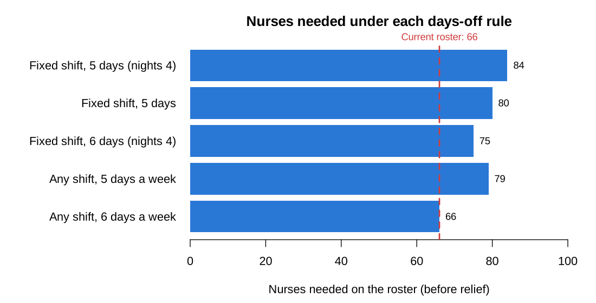
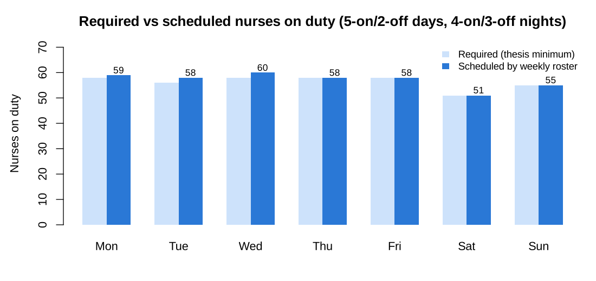

# Nurse Scheduling Optimization

**Integer linear programming for hospital nurse staffing, in R (lpSolve).** It reproduces and extends my MSc Applied Mathematics thesis at GIMPA.

> **Thesis:** *Optimizing Nurse Staffing Schedules at MedyLife Healthcare Using Linear Programming*
> Kwabena Asiedu Akyeampong · MSc Applied Mathematics, Ghana Institute of Management and Public Administration · October 2023 · Supervisor: Dr. Emmanuel Sarkodie Adabor · Grade: **A**

## The problem

Long shifts and too few days off drive burnout among nurses. MedyLife Healthcare (Accra) runs three shifts: morning 8am–2pm, afternoon 2pm–8pm and night 8pm–8am. Its duty roster was built by hand on a fixed cycle. The thesis asked: **what is the minimum number of nurses that must be on duty each day?**

The data is a one-week summary of the duty roster ([`data/medylife_roster_summary.csv`](data/medylife_roster_summary.csv)):

| Day | Morning | Afternoon | Night | Day off | Leave |
|---|---|---|---|---|---|
| Mon | 35 | 15 | 8 | 5 | 3 |
| Tue | 30 | 15 | 11 | 6 | 5 |
| Wed | 29 | 17 | 12 | 4 | 4 |
| Thu | 32 | 14 | 12 | 5 | 3 |
| Fri | 27 | 18 | 13 | 5 | 3 |
| Sat | 24 | 15 | 12 | 8 | 7 |
| Sun | 25 | 16 | 14 | 6 | 5 |

## Part 1: the thesis model ([`R/thesis_model.R`](R/thesis_model.R))

For each day, minimise the number of nurses *R = x₁ + x₂ + x₃ + x₄ + x₅* subject to:

```
x1 ≥ a  (morning)      x4 ≤ d  (day off)
x2 ≥ b  (afternoon)    x5 ≤ e  (leave)
x3 ≥ c  (night)        x1 + x2 + x3 − x4 − x5 ≥ 0
                       x1 + x2 − x3 ≥ 0,   all xᵢ integer ≥ 0
```

**Result:** the hospital needs **51–58 nurses on duty** each day against a roster of about 66. Saturday is the lightest day, at 51.

| Day | Mon | Tue | Wed | Thu | Fri | Sat | Sun |
|---|---|---|---|---|---|---|---|
| Minimum on duty | 58 | 56 | 58* | 58 | 58 | 51 | 55 |

<sub>*The thesis reports 55 for Wednesday because its model used Tuesday's afternoon and night figures (15 and 11). With the Wednesday data from the roster (17 and 12) the minimum is 58. The script uses the roster data.</sub>

## Part 2: extension, a weekly roster with real days off ([`R/weekly_roster_model.R`](R/weekly_roster_model.R))

The daily model answers "how many on duty?". By construction it sets days off and leave to zero, so it cannot say how many nurses the ward must **employ**. The thesis recommended adding days off and shift patterns next. This extension does that.

**Model.** Each nurse works a block of consecutive days, then has consecutive days off: 5-on/2-off for the 6-hour day shifts and 4-on/3-off for 12-hour nights. Let *yₖ* be the number of nurses whose block starts on day *k*. For each shift type:

```
minimise   Σₖ yₖ
subject to Σ (yₖ for every pattern k that works on day j)  ≥  requirementⱼ    for each day j
           yₖ integer ≥ 0
```

This is the classic cyclic staffing problem. The integer solution meets every daily requirement (surplus of 0–2 nurses a day) with **84 nurses**, or **95** with a 12% relief allowance for leave and sickness.



| Rostering rule | Nurses needed | With 12% relief |
|---|---|---|
| Fixed shift type; 5 days a week, nights 4 (base case) | 84 | 95 |
| Fixed shift type; 5 days for every shift | 80 | 90 |
| Fixed shift type; 6 days a week, nights 4 | 75 | 85 |
| Any nurse can work any shift; 5 days a week | 79 | 89 |
| Any nurse can work any shift; 6 days a week | **66** | 74 |

**What this adds to the thesis.** The current 66 nurses are only enough if every nurse works **six days a week** on whatever shift is needed. The data confirms it: 66 nurses share 39 days off a week, about **0.6 days off per nurse**. The thesis concluded there was no shortage of nurses on duty. The extension shows the hidden cost: the ward runs at minimum cover by giving nurses less than one day off a week, which is the burnout problem the study set out to address. Two days off for everyone would take about **80–84 nurses**.



## Run it

```bash
# R ≥ 4.0
Rscript -e 'install.packages("lpSolve")'
Rscript R/thesis_model.R           # Part 1 → results/thesis_daily_minimums.csv
Rscript R/weekly_roster_model.R    # Part 2 → results/*.csv and charts
```

## Limitations and next steps
- One week of aggregated data. A longer period would show seasonal and weekday patterns.
- Requirements are taken from the existing roster. Patient-demand data would allow true demand-based targets.
- Next: individual nurse preferences, skill mix (rank), and fairness of weekend work, using goal programming or a mixed-integer model in Python (OR-Tools or PuLP).

## Author
**Kwabena Asiedu Akyeampong**: MSc Applied Mathematics (GIMPA) · BSc Statistics (KNUST) · Fire & Safety Officer
[LinkedIn](https://linkedin.com/in/kwabena-akyeampong) · [GitHub](https://github.com/kobbyRollz)
